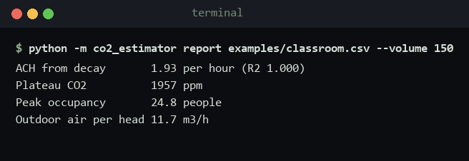

# co2-ventilation-estimator

[](https://github.com/yassine2med/co2-ventilation-estimator/actions/workflows/ci.yml)  

A CO2 sensor in a room tells you more than air quality. The way the curve falls after people leave gives the air change rate, and the plateau while they are inside gives a head count. This tool does both with plain mass balance maths and the standard library only.



## What it is for

Facility coordinators, building engineers and school or office managers often have CO2 loggers but no occupancy counter and no airflow measurement. With a room volume and a CSV from the logger, this tool estimates how many air changes per hour the room really gets, how many people were in it, and how much outdoor air each person received. The estimates are rough, but they are enough to spot a room that is under ventilated or over crowded.

## Install

```
git clone https://github.com/yassine2med/co2-ventilation-estimator
cd co2-ventilation-estimator && pip install -r requirements.txt
```

## How to use

| I want to | Command |
|---|---|
| Fit air changes per hour from the decay after people leave | `PYTHONPATH=src python -m co2_estimator ach examples/classroom.csv` |
| Get the full report: ACH, plateau, peak occupancy, outdoor air per head | `PYTHONPATH=src python -m co2_estimator report examples/classroom.csv --volume 150` |
| See occupancy for each interval when ACH is already known | `PYTHONPATH=src python -m co2_estimator occupancy examples/classroom.csv --volume 150 --ach 1.8` |
| Use a different outdoor CO2 level | add `--outdoor 450` |
| Show help | `PYTHONPATH=src python -m co2_estimator --help` |

The CSV has two columns: `time` (ISO 8601, like `2026-03-10T08:05`) and `ppm`. Exit codes: 0 on success, 2 for a missing file, a bad row, or a curve with no falling run to fit.

Example:

```
PYTHONPATH=src python -m co2_estimator report examples/classroom.csv --volume 150
```

Output:

```
ACH from decay       1.93 per hour (R2 1.000)
Plateau CO2          1957 ppm
Peak occupancy       24.8 people
Outdoor air per head 11.7 m3/h
```

The sample file is a simulated classroom (150 m3, 24 people, 1.8 air changes per hour, small sensor noise). The fit returns 1.93 and 24.8 people because the simulation steps every 5 minutes, which adds a small error.

Run the tests with `python -m pytest -q`.

## How it works

1. The model is `dC/dt = N * g / V - ACH * (C - Cout)`: CO2 in ppm, N people, g the CO2 each person breathes out (0.018 m3/h, a seated adult), V the room volume.
2. With nobody inside, `C - Cout` falls as `exp(-ACH * t)`. The tool takes the longest falling run of readings that stays 50 ppm above outdoor, fits a straight line to the logarithm, and the slope is the ACH.
3. At a steady level, `N = (C - Cout) * ACH * V / (g * 1e6)`. The plateau is the mean of the top 20 percent of readings.
4. For a series, each pair of readings gives `N = V * (dC/dt + ACH * (C - Cout)) / (g * 1e6)`, floored at zero.
5. Outdoor air per head is `ACH * V / N`.

## Limits

- One well mixed room and one sensor. Doors opening, sensors near a window and uneven mixing all add error.
- The plateau method assumes the CO2 reached a steady level. Short meetings never get there, so the head count comes out low.
- It needs a falling run in the data. A day with no one leaving gives no ACH, unless you pass your own with `occupancy`.
- Occupancy per interval is noisy because it uses the slope between two readings. Read trends, not single values.
- The per person rate is for light activity. Children and exercise change it, use `--per-person`.

## License

MIT. Yassine Emhamed, 2026.
